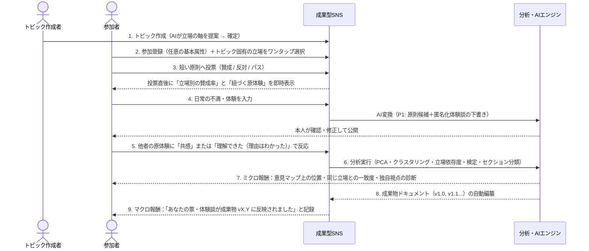

# 00 要件定義書（成果型SNSプラットフォーム）

## 1. 背景と目的

### 1.1 解決する課題
既存のSNSやオンライン議論ツールには、以下の構造的な課題が存在する。
1. **リプライ構造による炎上と分断**：直接の返信（リプライ）と反応数ベースのアルゴリズムが、怒りや極端な意見を拡散させる。
2. **「なぜそう考えるのか」の背景（立場・原体験）の欠落**：Polisなどの熟議ツールは短い意見への賛否投票によって合意点を見つけることに優れる一方、意見の背後にある「立場（利害・役割・環境）」や「現場の原体験」が切り離されるため、意見が割れた理由を構造的に理解できない。
3. **「立場による違い」の切り捨て**：人の意見の多くは置かれた立場や属性によって決まる側面があるにもかかわらず、従来の合意形成ツールは割れた意見を単なる「未合意」として除外してしまう。
4. **議論の「出口（成果物）」と参加報酬の不足**：投票や投稿が具体的なアウトプット（行動原則・ガイドライン・提言書など）にどう反映されたかが見えず、継続的な参加動機が保てない。

### 1.2 プラットフォームの目的
本プラットフォーム（成果型SNS）は、テーマを問わず以下の4点を同時に実現する汎用的な議論・合意編纂基盤を提供する。
1. **「短い原則（投票）」×「背景の原体験（追体験）」の2層構造**により、言い争いを防ぎながら主張の背景を共有する。
2. **立場ごとの見え方の違い（立場依存度・立場間ギャップ）**と、立場を越えて少数派の意見を投じた**「境界人」の原体験**を可視化し、対立の構造的な理解を促す。
3. 投票と原体験から、**「①立場を越えた共通原則」「②立場によって見え方が違う論点（分岐点）」「③条件付き合意案」「④立場によらず割れている論点」**を機械的ルールで分類し、バージョン管理された**成果物ドキュメント**を自動編纂する。
4. **ミクロ報酬（個人の立ち位置・同じ立場との一致度診断）**と**マクロ報酬（成果物への貢献履歴の可視化）**により、参加の手応えを返す。

---

## 2. 利用者像（アクター）と利用シナリオ

| アクター | 役割・特徴 | 主な要求 |
|---|---|---|
| **一般参加者** | トピックに関心を持ち、投票や日常のモヤモヤ・体験を投じる人 | 専門的な原則文を書けなくても参加したい。自分の立ち位置や、他の立場の人がなぜそう考えるのかを知りたい |
| **当事者・境界人** | 特定の立場で強い現場体験を持つ人、または自分の立場の多数派とは異なる考えに至った人 | 自分の現場のリアル（過去・現在・未来シナリオ）を安全に匿名化して伝え、建設的な条件案につなげたい |
| **トピック作成者・主催者** | 特定の課題（AI倫理、教育ルール、制作・権利、地域課題など）について議論の場を立てる人 | 適切な「立場の軸」を設定し、参加者の声から偏りの少ない実用的な成果物レポートを得たい |
| **成果物の閲覧・活用者** | 開発者、政策担当者、教育関係者、研究者など | どの項目が全体合意で、どの項目がどの立場間でなぜ割れているのかを、統計的根拠と原体験つきで把握したい |

---

## 3. 業務・利用フロー

---

## 4. 機能要件（Functional Requirements）

### 4.1 ユーザー・属性・立場管理
| ID | 要件名 | 内容 | 優先度 |
|---|---|---|---|
| **FR-01** | 匿名参加・基本属性登録 | ハンドル名のみで参加でき、年代・普段の役割などの基本属性を任意で登録できること。同意事項を明示すること | 必須 (MVP) |
| **FR-02** | トピック別「立場の軸」提案・設定 | トピック作成時にAIがそのテーマで意見が分かれそうな立場の軸（最大3軸、各2〜6選択肢＋「当てはまらない」）を提案し、作成者が編集・確定できること | 必須 (MVP) |
| **FR-03** | 立場のワンタップ選択と履歴保持 | 参加者がトピックごとに自分の立場をワンタップで選択・変更でき、投票時点の立場スナップショットが記録されること | 必須 (MVP) |

### 4.2 原則と原体験の2層構造・AI入力支援
| ID | 要件名 | 内容 | 優先度 |
|---|---|---|---|
| **FR-04** | 3択投票（イベント履歴方式） | 原則に対して「賛成(+1)／反対(-1)／パス(0)」で投票でき、上書きではなくイベント履歴として全票を保存すること | 必須 (MVP) |
| **FR-05** | 不満・体験から原則へのAI変換 (P1) | 自由記述の不満やモヤモヤから、80字以内の投票可能な原則候補（最大3件）と体験談の下書きを自動生成し、本人が確認・編集して投稿できること | 必須 (MVP) |
| **FR-06** | 重複原則の判定と統合 (P2) | 投稿された原則が既存の原則と実質的に同一である場合（条件や強さが同じ場合のみ）、既存原則へ統合し投稿者を誘導すること | 必須 (MVP) |
| **FR-07** | 原体験の投稿と匿名化支援 (P4) | 原則に対して「過去の体験」「現在の現実」「未来のシナリオ」を賛成・反対・背景の立場で紐づけられ、固有名詞等の自動マスクと要約を本人確認のうえ公開できること | 必須 (MVP) |
| **FR-08** | 2種類の反応（共感／理解できた） | 原体験に対して、同意を示す「共感」と、賛否を超えて理由の納得を示す「理解できた」を別々に記録できること | 必須 (MVP) |

### 4.3 分析エンジン（意見マップ・立場依存度・境界人）
| ID | 要件名 | 内容 | 優先度 |
|---|---|---|---|
| **FR-09** | 意見マップとクラスタリング | 7票以上投じた参加者の投票行列からPCA（主成分分析）とk-means法で意見グループを抽出し、前回スナップショットとハンガリアン法で番号を揃えること | 必須 (MVP) |
| **FR-10** | グループ考慮の合意度 (GIC) | 特定の多数派だけで合意が成立しないよう、各立場グループのラプラス平滑化賛成確率の積（GIC）を算出すること | 必須 (MVP) |
| **FR-11** | 立場依存度 (PD) と立場間ギャップ | ロジスティック回帰交差検証による立場依存度（PD）と、ベータ平滑化賛成率の最大差（立場間ギャップ）、およびカイ二乗／並べ替え検定＋Benjamini-Hochberg法（q値）を算出すること | 必須 (MVP) |
| **FR-12** | 立場のレンズ（クロス可視化） | 意見マップの色分けを「意見グループ」と「各立場の軸・基本属性」の間で自在に切り替え、NMI（正規化相互情報量）を表示できること | 必須 (MVP) |
| **FR-13** | 境界人の自動検出 | 分岐点において「自分の立場の多数派と逆（25%以下）であり、かつ他方の立場の多数派と一致する票」を投じた参加者の体験談に「★立場を越えた体験」バッジを付与すること | 必須 (MVP) |
| **FR-14** | 体験談の順位づけ | 異なる立場からの「理解できた」の幾何平均（CU）、同じ立場からの「共感」（R）、境界人ボーナスを組み合わせて体験談を順位づけすること | 必須 (MVP) |
| **FR-15** | 条件付き合意案の提案 (P5) | 分岐点となった原則に対し、賛成側・反対側・境界人の体験談から双方の懸念を抽出し、条件付きの新しい原則案を生成して投票にかけられること | 必須 (MVP) |

### 4.4 ミクロ報酬・マクロ報酬・成果物ジェネレーター
| ID | 要件名 | 内容 | 優先度 |
|---|---|---|---|
| **FR-16** | 個人の立ち位置診断（ミクロ報酬） | 立場によって割れる論点への投票から「同じ立場の多数派との一致率」と「あなたならではの論点（少数派視点）」、および同クラスター／別クラスターの代表体験談を表示すること | 必須 (MVP) |
| **FR-17** | 機械的ルールによるセクション分類 | 数値基準のみによって、原則を「①立場を越えた共通原則」「②立場によって見え方が違う論点」「③条件付き合意案」「④立場によらず割れている論点」「⑤データ不足」に分類すること | 必須 (MVP) |
| **FR-18** | 成果物ドキュメントの自動編纂 (P6) | セクション分類結果・立場別統計・代表体験談から、引用マーカー（`[S:id]`, `[T:id]`）つきの成果物レポートをバージョン管理（v1.0, v1.1...）しながら生成すること | 必須 (MVP) |
| **FR-19** | 貢献履歴の記録と表示（マクロ報酬） | 成果物の新バージョン生成時に「原則の採用」「体験談の引用」「投票による貢献」を記録し、参加者が自分の貢献一覧を確認できること | 必須 (MVP) |

---

## 5. 非機能要件（Non-Functional Requirements）

| ID | 区分 | 要件内容 |
|---|---|---|
| **NFR-01** | **プライバシー（最小人数ルール）** | 立場別集計および意見マップの属性ラベル表示において、賛成＋反対の有効回答が **10人未満** のグループは個別の賛成率を表示せず「人数不足（非表示）」または「その他」に統合すること。 |
| **NFR-02** | **表示の中立性・倫理** | 画面および成果物において「ポジショントーク」等の動機を決めつける言葉を使用せず、「立場によって見え方が大きく違う論点」と表現し、必ず体験談とセットで表示すること。 |
| **NFR-03** | **AIの権限分離（民主的統制）** | AIが生成した原則や条件付き合意案は、必ず参加者の投票を経て数値基準を満たした場合のみ成果物に採用されること。また、成果物のどのセクションにどの原則が入るかはAIではなく決定論的な数値ルールで決めること。 |
| **NFR-04** | **再現性と監査可能性** | 分析実行時のパラメータ・統計値・マップ座標を `ANALYSIS_SNAPSHOT` として保存し、成果物の全記述に原則ID `[S:id]`・体験談ID `[T:id]` の引用を紐づけること。 |
| **NFR-05** | **外部API非依存の可用性** | LLM APIキーが設定されていない環境でも、決定論的なルール変換・テンプレート編纂によって全機能が停止せず動作すること。 |
| **NFR-06** | **ライセンスの独立性** | Polis（AGPL-3.0）のソースコードは流用せず、公開された数理アルゴリズム（PCA、k-means、ラプラス平滑化GIC、Benjamini-Hochberg法）を独自実装すること。 |

---

## 6. 今後の拡張要件（フェーズ2〜3）
- **信頼レベル（Trust Level）と立場の認証**：メール認証・電話番号認証・所属ドメイン認証（例：教育機関ドメイン `.ed.jp` / `.ac.jp`）による重みづけ集計と、確認済み参加者のみの比較集計表示。
- **異常投票パターンの検知**：短時間に同一パターンの投票を行うボット・組織票の自動保留。
- **外部出力フォーマット**：AIモデルのシステムプロンプト／Constitutional AI 学習用原則リスト（JSONL）や自治体・組織向けPDFレポートとしてのエクスポート機能。
