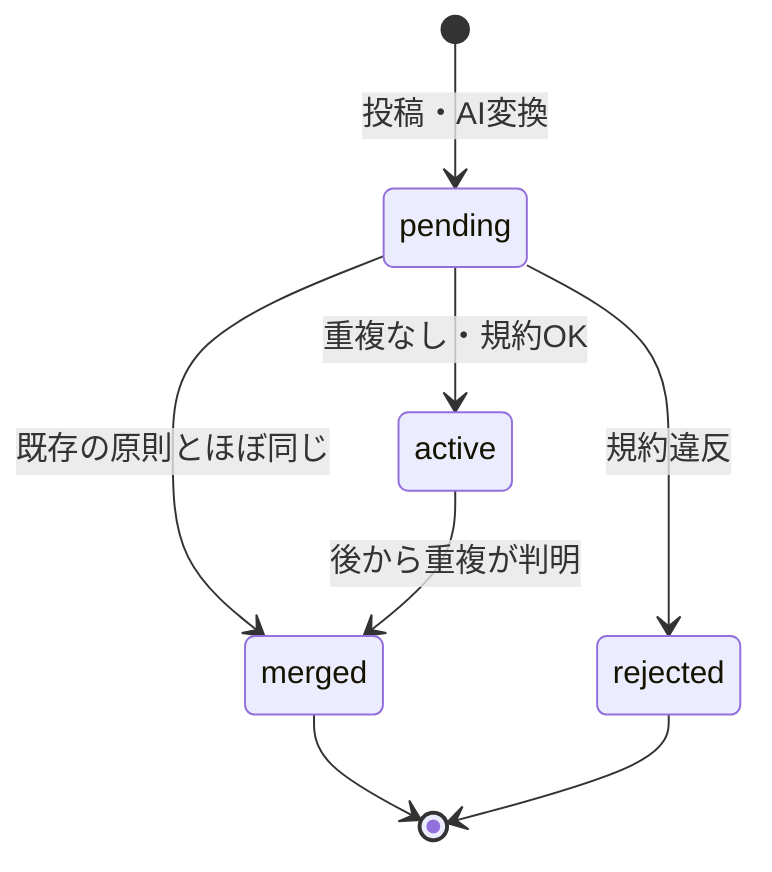

# 01 データモデル

## 1. ER図

```mermaid
erDiagram
    USER ||--o{ USER_ATTRIBUTE : has
    USER ||--o{ USER_TOPIC_POSITION : selects
    TOPIC ||--o{ POSITION_AXIS : defines
    POSITION_AXIS ||--o{ POSITION_OPTION : has
    POSITION_OPTION ||--o{ USER_TOPIC_POSITION : chosen
    TOPIC ||--o{ STATEMENT : contains
    USER ||--o{ STATEMENT : authors
    USER ||--o{ VOTE_EVENT : casts
    STATEMENT ||--o{ VOTE_EVENT : receives
    USER_TOPIC_POSITION ||--o{ VOTE_EVENT : "snapshot at vote"
    USER ||--o{ STORY : writes
    STORY ||--o{ STORY_STATEMENT_LINK : links
    STATEMENT ||--o{ STORY_STATEMENT_LINK : grounded_by
    USER ||--o{ STORY_REACTION : reacts
    STORY ||--o{ STORY_REACTION : receives
    TOPIC ||--o{ ANALYSIS_SNAPSHOT : analyzed
    ANALYSIS_SNAPSHOT ||--o{ STATEMENT_STATS : contains
    ANALYSIS_SNAPSHOT ||--o{ GROUP_STATS : contains
    ANALYSIS_SNAPSHOT ||--o{ USER_PROJECTION : contains
    ANALYSIS_SNAPSHOT ||--|| REPORT_VERSION : produces
    REPORT_VERSION ||--o{ REPORT_CITATION : cites
    REPORT_VERSION ||--o{ CONTRIBUTION : credits
    USER ||--o{ CONTRIBUTION : earns

    USER {
        uuid id PK
        string handle "表示名（匿名可）"
        int trust_level "0-3 不正対策用"
        timestamp created_at
    }
    USER_ATTRIBUTE {
        uuid user_id FK
        string key "age_band, occupation など"
        string value
        string verification "self, email_domain, document"
        timestamp updated_at
    }
    TOPIC {
        uuid id PK
        string title
        text description
        string status "draft, open, closed"
        string seed_question "例: 教育現場でAIはどう振る舞うべきか"
    }
    POSITION_AXIS {
        uuid id PK
        uuid topic_id FK
        string name "例: このテーマとの関わり方"
        string source "ai_proposed, admin, community"
        bool multi_select
    }
    POSITION_OPTION {
        uuid id PK
        uuid axis_id FK
        string label "例: 使う側"
    }
    USER_TOPIC_POSITION {
        uuid id PK
        uuid user_id FK
        uuid option_id FK
        timestamp valid_from
        timestamp valid_to "変更時に閉じる"
    }
    STATEMENT {
        uuid id PK
        uuid topic_id FK
        uuid author_id FK
        text body "140字以内"
        string origin "user, ai_from_complaint, ai_bridge, seed"
        string status "pending, active, merged, rejected"
        uuid merged_into FK
        vector embedding
    }
    VOTE_EVENT {
        uuid id PK
        uuid user_id FK
        uuid statement_id FK
        int value "1 賛成, -1 反対, 0 パス"
        json position_snapshot "投票時点の立場"
        timestamp created_at
    }
    STORY {
        uuid id PK
        uuid author_id FK
        uuid topic_id FK
        string kind "past, present, future"
        text body
        text summary "AIによる要約"
        string anonymization "none, ai_masked_user_approved"
        string visibility "public, aggregate_only"
    }
    STORY_STATEMENT_LINK {
        uuid story_id FK
        uuid statement_id FK
        string stance "supports, opposes, context"
    }
    STORY_REACTION {
        uuid user_id FK
        uuid story_id FK
        string kind "resonate, understand"
        json position_snapshot
    }
    ANALYSIS_SNAPSHOT {
        uuid id PK
        uuid topic_id FK
        timestamp computed_at
        json params "閾値・アルゴリズムのバージョン"
    }
    STATEMENT_STATS {
        uuid snapshot_id FK
        uuid statement_id FK
        int n_seen
        int n_agree
        int n_disagree
        float gic_agree "グループ考慮の合意度"
        float pd "立場依存度"
        float gap "立場間の賛成率の最大差"
        float q_value
        string section "consensus, divergence, bridge, undecided"
    }
    GROUP_STATS {
        uuid snapshot_id FK
        uuid statement_id FK
        string group_type "cluster, position"
        string group_key
        int n
        int n_agree
        int n_disagree
    }
    USER_PROJECTION {
        uuid snapshot_id FK
        uuid user_id FK
        float x
        float y
        int cluster_id
    }
    REPORT_VERSION {
        uuid id PK
        uuid topic_id FK
        string version "1.0, 1.1 など"
        uuid snapshot_id FK
        text body_md
        json diff "前版からの変化"
    }
    REPORT_CITATION {
        uuid report_version_id FK
        string section_key
        string ref_type "statement, story"
        uuid ref_id
    }
    CONTRIBUTION {
        uuid user_id FK
        uuid report_version_id FK
        string kind "vote, decisive_vote, story_cited, statement_adopted"
        uuid ref_id
        float weight
    }
```

## 2. 設計上の判断

### 2.1 投票は「上書き」ではなく「イベント」で持つ
- `VOTE_EVENT` に全履歴を残し、現在の票は「ユーザー×原則ごとの最新イベント」とする。
- 理由：①考えが変わった記録そのものが価値ある情報（「体験談を読んで反対→賛成に変わった」）、②貢献の記録で「どの時点の票が成果物を変えたか」を追える。

### 2.2 立場は投票時点の写し（スナップショット）を残す
- 立場は途中で変わりうる（転職、立場の選び直し）。集計には**投票時点の立場**を使う。
- `USER_TOPIC_POSITION` は有効期間（`valid_from`/`valid_to`）で履歴を持つ。

### 2.3 属性は2層に分ける
| 層 | 例 | 入力のタイミング | 用途 |
|----|----|------------------|------|
| 基本属性 `USER_ATTRIBUTE` | 年代、職業分類、地域 | 初回登録時（任意項目あり） | テーマを横断した比較 |
| トピック固有の立場 `USER_TOPIC_POSITION` | 提供する側／使う側／規制する側 | トピック参加時にワンタップ | そのテーマでの立場依存の分析 |

- トピック固有の立場の軸は、AIが提案し、運営またはコミュニティが承認する（[03](./03_AIパイプライン.md) 参照）。
- 軸は1トピックにつき**最大3本、各軸は選択肢2〜6個**を上限にする。組み合わせが増えすぎると、各グループの人数が足りず統計が成り立たなくなり、個人の特定にもつながるため（[04](./04_プライバシーと不正対策.md)）。

### 2.4 原体験の反応は「共感」と「理解できた」を分ける
- `resonate`（共感）：同じ立場・同じ意見の人が押すことが多い。
- `understand`（賛成はしないが、そう考える理由はわかった）：**立場を越えた理解**を測る、このサービス独自の指標。
- 反応にも立場の写しを残し、「異なる立場の人から『理解できた』を多く得た体験談」を見つけられるようにする。

### 2.5 原則の状態の遷移

- `merged` になった原則の投稿者には「あなたの意見は既存の原則 #123 として投票中です」と知らせ、貢献は統合先に引き継ぐ。
- AIが作った原則（`ai_from_complaint`, `ai_bridge`）も、**必ず投票を経てから**成果物に入る。AIの文章が直接成果物に載ることはない。

### 2.6 分析結果は「スナップショット」として固定する
- 分析を実行するたびに `ANALYSIS_SNAPSHOT` を作り、その時点の統計・マップ座標・成果物をひとまとめにして保存する。
- 理由：成果物の各バージョンが「どのデータに基づいたか」を後から再現・検証できるようにするため（透明性）。
