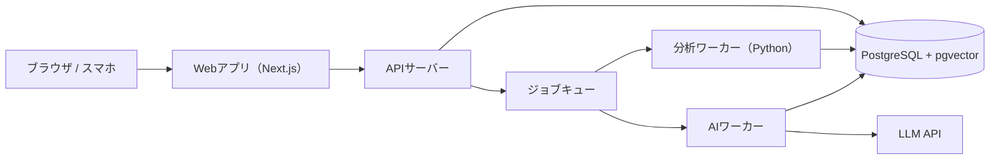
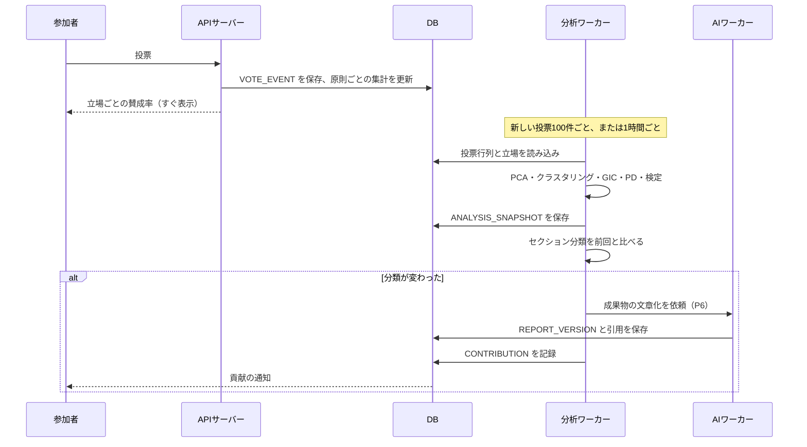

# 05 システム構成とMVP

## 1. 技術構成（案）

| 部分 | 候補 | 選んだ理由 |
|------|------|------------|
| 画面 | Next.js（TypeScript） | 意見マップなどの対話的な画面を作りやすい。スマホのブラウザでも動く |
| データベース | PostgreSQL ＋ pgvector | 投票・属性の集計に強い。原則・体験談の類似検索も同じDBでできる |
| 分析 | Python（numpy, scikit-learn, scipy） | PCA、k-means、ロジスティック回帰、検定がすべてそろっている |
| AI | LLM API（小型＋大型の使い分け） | [03](./03_AIパイプライン.md) 参照 |
| ジョブキュー | 最初はDBのテーブルで代用 | 規模が小さいうちは専用の仕組みは不要 |

### 1.1 Polisとの関係（方針案）

Polis（compdemocracy/polis、AGPL-3.0）をそのまま改造する（フォークする）のではなく、**アプリは自分たちで作り、Polisの成果は次の3つの形で使う**。

| 使い方 | 中身 |
|--------|------|
| アルゴリズムの参考 | PCA・k-means・合意度の計算は、Polis本体や Python版の再実装 red-dwarf（polis-community）を参考にする。コードを流用する場合はライセンスを確認する |
| 検証用のデータ | Polisが公開している過去の議論データで、自分たちの計算が Polis と近い結果になるかを確かめる |
| 初期の実験 | 開発前に、Polisをそのまま使って小さな議論を開き、立場の情報を別のフォームで集めて手作業で分析する |

理由：Polisは「1つの議論を埋め込んで使う道具」として作られており、参加者のプロフィール、トピックをまたぐ利用、体験談、成果物のバージョン管理といった、このサービスの中心となる部分がない。また Node.js（TypeScript）と Clojure（計算部分）など複数の言語で書かれていて、改造の負担が大きい。

## 2. 再計算の流れ

## 3. 段階的な開発計画

### フェーズ0：アルゴリズムの検証（1〜2週間）
- 架空の参加者データ（立場と投票の関係をわざと仕込んだもの）を作り、[02](./02_アルゴリズム.md) の計算が意図どおりに動くかを確かめる。
  - 立場で決まるように作った原則で PD・ギャップが高く出るか
  - 立場と無関係に作った原則が、誤って分岐点にならないか
  - 少数の境界人を正しく見つけられるか
- 公開されている Polis の議論データ（Polis がオープンデータとして公開しているもの）で、クラスタリングが Polis の結果と近くなるかを確かめる。

### フェーズ1：最小限のプロトタイプ（4〜6週間）
**目標**：知り合い30〜100人で、1つのトピックを最後まで回す。

含めるもの：
- トピック作成（立場の軸は手動で設定）
- 立場の選択 → 原則への投票（賛成／反対／パス）
- 原則の投稿（P1の変換つき）
- 体験談の投稿と原則への紐づけ（匿名化は手動確認）
- 立場ごとの賛成率の表示、意見マップ、立場のレンズ
- 個人の診断（立場らしさ、あなたならではの論点）
- 成果物の生成（P6）と手動での公開

含めないもの：信頼レベル、境界人の検出、条件付き合意案（P5）、貢献の通知、重複の自動判定

### フェーズ2：成果物と報酬の完成
- 境界人の検出と体験談のハイライト
- 条件付き合意案（P5）
- 成果物の自動バージョン管理と貢献の通知
- 「理解できた」反応と、立場を越えた理解（CU）による順位づけ

### フェーズ3：公開に向けて
- 信頼レベルと不正検知
- 立場の軸の自動提案（P3）
- 重複の自動判定（P2）
- 個人情報保護の専門家の確認、利用規約の整備

## 4. 検証したい問い（フェーズ1で確かめること）

| 問い | 測り方 |
|------|--------|
| 参加者は、立場ごとの違いを見て「相手の考えが理解できた」と感じるか | 体験談への「理解できた」の割合、終了時のアンケート |
| 個人の診断は、もっと投票したくなる動機になるか | 診断が出る前後での投票数の変化 |
| 体験談を読むと、考えは変わるか | 体験談を読んだ後に票を変えた割合（`VOTE_EVENT` の履歴） |
| 成果物は、参加者にとって「自分たちのもの」と感じられるか | 各立場の参加者による公平さの評価（[03](./03_AIパイプライン.md#評価の方法)） |

## 5. 未決事項

1. **最初の成果物を誰に届けるか**：AI開発企業、学校・自治体、一般公開のいずれか。届け先によって、成果物の形式（原則文、評価基準、提言書）が変わる。
2. **トピックを誰が立てられるか**：運営だけ／認証済みの団体／誰でも。誰でも立てられると、立場の軸の質を保つのが難しくなる。
3. **参加者をどう集めるか**：自由参加だと偏る。特定のトピックで、無作為に選んだ人に謝礼つきで参加してもらう「代表性の高い回」を設けるか。
4. **体験談の真偽をどう扱うか**：確かめることはできない。「確認されていない個人の体験」と明示するだけでよいか。
5. **立場の軸を途中で変えたいとき**：既存の票の立場は記録されていないため、追加の質問で後から立場を聞くか。
6. **収益の形**：成果物の作成を団体から受託する／分析機能を有料にする／助成金など。
