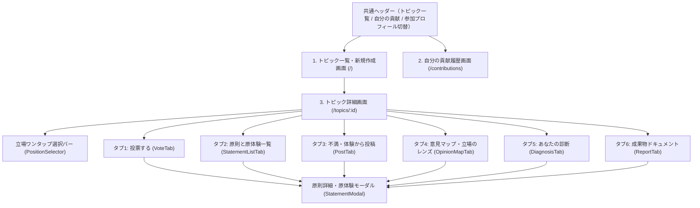

# 07 画面設計・機能仕様書

本ドキュメントは、`frontend/`（React + TypeScript + Vite）および `backend/`（FastAPI + SQLAlchemy）として実装されたプラットフォームの各画面・コンポーネントの仕様を定義します。

---

## 1. 画面遷移図

---

## 2. 各画面・コンポーネント仕様

### 2.1 参加プロフィール設定パネル (`RegisterPanel`)
- **表示条件**：未ログイン時（トークン未保持時）に画面上部に表示。
- **入力項目**：
  - 表示名（ニックネーム、既定値「ゲスト参加者」）
  - 基本属性（`GET /api/meta` から取得する「年代」「普段の役割」、すべて任意選択）
- **プライバシー明示**：「10人以上のグループ単位での統計表示のみに使われ、個別の投票内容が公開されることはない」旨を明記。

### 2.2 トピック一覧・新規作成画面 (`TopicListPage` - `/`)
- **一覧カード**：トピックのタイトル、説明、参加者数、原則数、公開中の最新成果物バージョンバッジ（例：`成果物 v1.0 公開中`）を表示。
- **新規トピック作成フォーム**：
  - タイトル・説明を入力後、「AIに『立場の軸』を提案してもらう」ボタン（`POST /api/topics/suggest-axes`）で、そのテーマで意見が分かれそうな軸と選択肢、およびその理由（`why_divergent`）を自動取得。
  - 作成者が軸名と選択肢を編集して公開（`POST /api/topics`）。自動的に各軸へ「当てはまらない」選択肢が付与される。

### 2.3 立場ワンタップ選択バー (`PositionSelector`)
- トピック詳細画面の上部に常設。
- トピック固有の立場の軸（例：「教育現場との関わり方」「日常での生成AIの利用頻度」）ごとに選択肢ボタンを並べ、ワンタップで `PUT /api/topics/{id}/positions` を呼び出して即時反映する。

### 2.4 タブ1：投票する (`VoteTab`)
- **進捗バー**：全体の原則数に対する自分の投票済み数を表示。
- **投票カード**：未投票の原則を1問ずつ取得（`GET /api/topics/{id}/next-statement`）し、「賛成」「反対」「パス・判断保留」「体験談を読んでから考える」の4つのアクションを提供。
- **投票直後のフィードバック**：投票した瞬間に、直前の原則に対する「立場別の賛成率（横棒グラフ）」と「この原則の体験談を読む・書く」ボタンを下部に表示する。

### 2.5 タブ2：原則と原体験一覧 (`StatementListTab`)
- **セクション別フィルター**：
  - `すべて`
  - `立場を越えた共通原則`（全立場で70%以上賛成）
  - `立場によって見え方が違う論点`（q < 0.05 かつ ギャップ 30pt以上）
  - `条件付き合意案`（全立場で55%以上賛成の橋渡し原則）
  - `立場によらず割れている論点`（全体賛成率35〜65%で立場相関が低いもの）
  - `データ不足`
- フィルター選択時には、そのセクションの意味と解釈上の注意点をカードで表示する。
- 各原則カードには、セクションバッジ、立場間ギャップの言葉（「立場によって見え方が大きく違う（差 61pt）」など）、紐づく原体験の件数、賛成・反対・パスの票数、自分の投票を表示する。

### 2.6 タブ3：不満・体験から投稿 (`PostTab`)
- **モード1：日常の不満・モヤモヤ・現場の体験から原則を作る（AI変換 P1）**
  - 自由記述欄に入力して「投票できる原則に変換する」を押すと、`POST /api/topics/{id}/convert` を実行。
  - 変換された原則候補（最大3件）をクリックで切り替え・テキスト修正でき、同時に抽出された「背景の原体験（匿名化済み下書き）」をチェックボックスひとつで一緒に紐づけて公開できる。
- **モード2：直接原則を書き込む**
  - 140字以内の原則文を直接投稿する。
- **重複統合・規約チェック結果の表示**：
  - 既存の原則と実質的に同じ場合は「既存の原則 #X に統合されました」と統合先への導線を表示し、体験談があれば統合先へ自動で紐づける。
  - 攻撃的表現等が含まれる場合は理由を表示して修正を促す。

### 2.7 タブ4：意見マップ・立場のレンズ (`OpinionMapTab`)
- **SVG散布図**：PCA＋k-meansによる参加者マップを描画し、ログイン中のユーザーの位置を強調表示（「あなた」）する。
- **立場のレンズ切替**：
  - 「色分け：意見グループ（投票パターンのみ）」と「立場のレンズ：（各軸・基本属性）」をセレクトボックスで即座に切り替え可能。
  - 10人未満の属性グループは自動的に「その他」に統合して再識別を防ぐ。
- **意見グループと立場の重なり度合い**：各軸との正規化相互情報量（NMI）を表示。
- **グループ別の代表原則**：各意見グループの人数と、そのグループで特に賛成率が高い原則上位3件を表示。

### 2.8 タブ5：あなたの診断 (`DiagnosisTab` ― ミクロ報酬)
- 立場によって意見が割れる論点への投票が規定数に達するまでは「あと◯問投票すると診断が表示されます」と進捗を案内。
- 投票が揃うと以下を表示：
  1. **所属する意見グループ**
  2. **同じ立場の人との一致度**：「立場によって意見が割れる X 問のうち、あなたは Y 問（Z%）で『（自分の立場）』の多数派と同じ答えでした」（中立的な文言で表示）
  3. **あなたならではの論点**：自分の立場で25%以下の少数派にあたる投票をした原則を、情報量（驚き度）順に最大3件ハイライトし、なぜそう考えたのかの体験談投稿を促す。
  4. **体験談の対比**：あなたと同じ意見グループの人の原体験と、異なる意見グループの人の原体験を1件ずつ並べて表示。

### 2.9 タブ6：成果物ドキュメント (`ReportTab` ― マクロ報酬への出口)
- **バージョン選択**：過去に生成された成果物の全バージョン（`v1.0`, `v1.1`...）をプルダウンで切り替え可能。
- **即時再計算ボタン**：「最新の投票で分析・成果物を更新」（`POST /api/topics/{id}/analyze`）により、最新の投票・体験談を反映して再分析・再編纂を実行。
- **インタラクティブ引用リンク**：成果物本文中の `[S:12]` をクリックすると、該当する原則 `#12` の詳細・原体験モーダルがその場で開く。

### 2.10 原則詳細・原体験モーダル (`StatementModal`)
- **立場別賛成率バー (`PositionRateBars`)**：すべての立場の軸・基本属性ごとに賛成率の横棒グラフを表示（10人未満は「人数不足（10人未満のため非表示）」）。
- **条件付き合意案の提案ボタン（分岐点のみ表示）**：
  - `POST /api/statements/{id}/bridges` を呼び出し、賛成側の重視点・反対側の懸念点を整理した上で、新しい条件付き原則を投票リストへ追加する。
- **原体験の対比表示 (`StoryCardView`)**：
  - 「賛成側の体験談」「反対側の体験談」「背景・状況」に分けて表示。
  - 境界人（自分の立場の多数派と逆の票を入れた人）の体験談には **「★ 立場を越えた体験」** バッジを表示。
  - 各体験談に **「共感」** ボタンと **「理解できた（理由はわかった）」** ボタンを備える。
- **原体験の投稿フォーム**：
  - 「匿名化・要約を確認」ボタン（`POST /api/stories/anonymize`）で固有名詞や日付のマスク結果と要約を確認・手直ししてから投稿できる。
