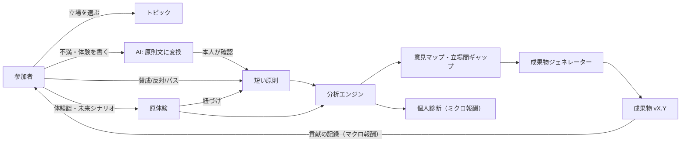

# 成果型SNS 設計仕様書・要件定義書一覧

## コンセプト（1行）

**「誰が・どの立場から・どんな体験をもとにそう言っているのか」を明らかにしながら、短い原則への投票を集め、合意点と立場ごとの分かれ目をまとめた成果物を自動で作るプラットフォーム。**

## 4つのコア機能

| # | 機能 | 中身 |
|---|------|------|
| 1 | 2層構造 | 短い原則（投票の対象）＋その根拠となる原体験・未来シナリオ（追体験の対象） |
| 2 | 立場による違いの解剖 | 論点ごとに「どれだけ立場で賛否が分かれているか」を計算し、立場別の違いと背景の原体験をセットで見せる |
| 3 | 成果物ジェネレーター | 共通原則・分岐点・条件付き合意案・価値観の分岐をまとめたドキュメントを、バージョン管理しながら自動で編纂する |
| 4 | 報酬設計 | ミクロ（自分の位置・同じ立場との一致度と独自視点の診断）とマクロ（成果物への貢献の記録）の2つ |

## ドキュメント構成

| ファイル | 内容 |
|----------|------|
| [00_要件定義書.md](./00_要件定義書.md) | 背景・目的、利用者像、利用フロー、機能要件（FR-01〜19）、非機能要件（NFR-01〜06） |
| [01_データモデル.md](./01_データモデル.md) | エンティティ、ER図、履歴保持・スナップショット等の設計判断 |
| [02_アルゴリズム.md](./02_アルゴリズム.md) | クラスタリング、合意度（GIC）、**立場依存度（PD）と立場間ギャップ**、個人診断、境界人の検出、体験談の順位づけ、貢献の記録 |
| [03_AIパイプライン.md](./03_AIパイプライン.md) | 不満→原則の変換、重複統合、立場の軸の提案、匿名化、条件付き合意案、成果物の文章化のプロンプトとフォールバック設計 |
| [04_プライバシーと不正対策.md](./04_プライバシーと不正対策.md) | 属性データの扱い、最小人数ルール（10人未満非表示）、なりすまし対策、表示上の倫理（「ポジショントーク」という語を使わない中立表現） |
| [05_システム構成とMVP.md](./05_システム構成とMVP.md) | Polisとの関係・独自実装方針、技術構成、再計算の流れ、段階的な開発計画 |
| [06_API仕様.md](./06_API仕様.md) | バックエンドとフロントエンド間の全エンドポイント・型定義 |
| [07_画面設計・機能仕様書.md](./07_画面設計・機能仕様書.md) | 画面遷移図、各画面・タブ・モーダルの詳細仕様 |

## 実装ディレクトリ構成

| ディレクトリ | 内容 | 起動・検証コマンド |
|---|---|---|
| [backend/](../backend/README.md) | FastAPI + SQLAlchemy + NumPy/SciPy による分析エンジン・AIパイプライン・シードデータ（80名×12原則） | `cd backend && uv run uvicorn app.main:app --reload --port 8000` / テスト: `.\.venv\Scripts\pytest.exe -v` |
| [frontend/](../frontend/README.md) | React + TypeScript + Vite によるWebアプリケーション（投票・AI変換投稿・意見マップ・立場のレンズ・診断・成果物ビューア） | `cd frontend && npm run dev` / ビルド: `npm run build` |

## 全体の流れ

## 用語

| 用語 | 定義 |
|------|------|
| トピック | 議論の単位（例：「教育現場での生成AI活用と行動原則」） |
| 原則（Statement） | 投票対象となる短い文。「〜すべきだ」「〜してほしい」「〜してはならない」の形 |
| 原体験（Story） | 原則の根拠となる文章。種類は「過去の体験」「現在の現実」「未来のシナリオ」の3つ |
| 立場の軸 / 立場 | トピックごとに定める関わり方の軸（例：教員・生徒・保護者・開発者）とその選択肢 |
| 意見グループ（クラスター） | 投票パターンが似た人のグループ。立場とは無関係に、投票だけから計算する |
| 立場依存度（PD） | ある原則への賛否が、立場の情報だけでどれだけ予測できるか（0〜1、内部判定用） |
| 立場間ギャップ | 立場どうしの平滑化賛成率の最大差（画面表示用、例：最大差 61pt） |
| 分岐点 | 立場間で賛否が大きく割れ、それが統計的に確かな原則 |
| 境界人 | 自分の立場の多数派と逆の投票をした人（論点ごとに判定し、体験談に「★立場を越えた体験」を表示） |
| 成果物 | 分析結果をまとめたドキュメント。バージョンつきで更新される |
